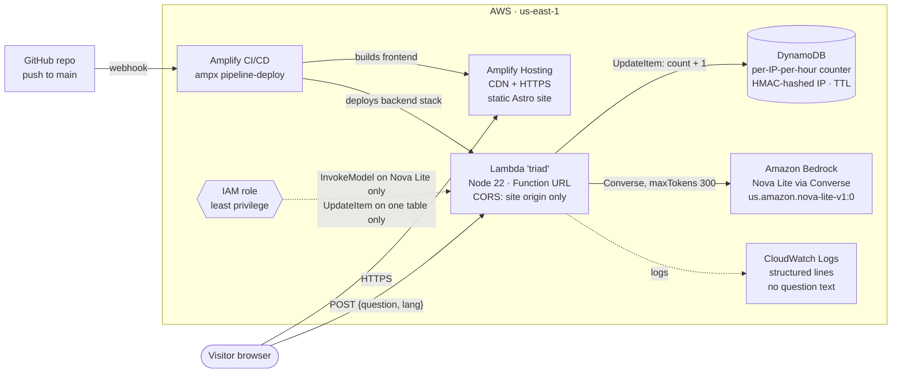

# SEE YOU SPACE BUILDER

**Live:** https://main.dx1vkp1smlyu7.amplifyapp.com

My portfolio for the AWS Student Builder Challenge "Build Your Tech Superpower". It looks like an Evangelion × Cowboy Bebop HUD, and it hides a Hyprland-style desktop where three AI cores, running on Amazon Bedrock, vote on your questions.

I'm Pablo Nicolás Marín, a Systems Engineering student at Universidad del Valle (Buga, Colombia), AWS Certified Cloud Practitioner, and Partnerships & Academy Lead at the AWS Student Builder Group Univalle.

## What's on the site

- **About:** who I am, styled as an episode title card and a pilot dossier.
- **Skills:** grouped skill bars ("sync ratio").
- **Sessions:** seven projects as wanted posters, each with its stack and links.
- **Mission Log:** certifications, roles, hackathons and open-source work.
- **EN / ES** toggle (the choice is remembered), mobile layout at 390 px, and `prefers-reduced-motion` support.

## How to find the secret: Omarchy Mode

Press the blinking **⚠ EMERGENCY — PRESS ⊞ SUPER** button in the hero or navbar. You get an emergency boot sequence (any key or tap skips it), then a tiling desktop inspired by [Omarchy](https://omarchy.org) and Hyprland, the setup I use every day.

| Where | Key | What it does |
|---|---|---|
| Normal page | Click the hint, **Super** (Windows/Meta key), or **Ctrl+K** / **Cmd+K** | Open Omarchy Mode |
| Desktop | **T** or **Enter** (also Super/Ctrl+Enter) | Open a terminal |
| Desktop | **1**–**5** (also Super/Ctrl+1..5) | Switch workspace: 1 About, 2 Sessions, 3 Skills, 4 TRIAD, 5 Log |
| Desktop | **P** (also Super/Ctrl+P) | Display Switch: re-theme the desktop (Eva / Bebop / Omarchy) |
| Desktop | **Q** (also Super/Ctrl+Q) | Close the focused window |
| Desktop | **Esc** or **Ctrl+K** | Exit back to the page, at the same scroll position |
| Mobile (< 768 px) | Dock buttons or horizontal swipe | One fullscreen window at a time |

Plain keys work only when you're not typing in an input. Browsers swallow some Ctrl chords, like Ctrl+1..5 and Ctrl+Q, and that's why plain keys exist. Inside an input, the first **Esc** leaves the field and the next one exits. The dock has a button for every shortcut, so you don't need a keyboard.

**Terminal commands:** `help`, `whoami`, `ls sessions`, `cat about.md`, `neofetch`, `open <n>` (opens session *n* in a window), `lang en|es`, `clear`, `exit`.

**TRIAD (workspace 4):** ask a yes/no question of up to 200 characters. Three cores answer:

- **CORE·ENGINEER:** logical and technical.
- **CORE·COWBOY:** laid-back and intuitive.
- **CORE·STUDENT:** curious.

Each core gives YES or NO plus one line, and a banner shows the result, for example `RESOLUTION: APPROVED 2–1`. The cores know my profile, so you can ask them about me. If the backend can't be reached, TRIAD answers from a local pool and shows `LINK LOST — LOCAL MODE`, so it never ends in a broken state.

## Architecture



Request flow for a TRIAD question:

1. The browser sends `POST { question, lang }` to the Lambda Function URL. It has an 8 s budget; past that it switches to local mode.
2. The Lambda checks the input (trimmed, 1–200 characters, `en` or `es`). Then it increments a DynamoDB counter keyed by `HMAC(ip) + hour`; past 30 requests in that hour it returns 429 `rate_limited`. Next it increments a global counter `global:<hour>`; past 300 requests per hour from everyone it returns 429 `busy`. The browser then shows "QUOTA REACHED — LOCAL MODE" and answers from its local pool.
3. One Bedrock `Converse` call to Nova Lite. The system prompt holds my profile and the three personas, and the model must return JSON.
4. The Lambda parses the JSON leniently. If the reply isn't usable, it retries once at temperature 0.2, but only if that retry can still finish inside the browser's budget. **The verdict is computed in code from the three votes and never taken from the model.** The browser recomputes it again.
5. The Lambda writes one structured log line (`status`, `qLen`, `lang`, `retried`, `ms`) and never logs the question text.

The whole backend is code in [`amplify/backend.ts`](amplify/backend.ts) (Amplify Gen 2 plus CDK), and Amplify deploys it on every push to `main`.

## AWS services

| Service | What it does here | Why |
|---|---|---|
| **AWS Amplify Hosting** | Serves the static Astro build over a global CDN with HTTPS. CI/CD from GitHub: each push to `main` runs the backend phase (`ampx pipeline-deploy`) and then the frontend build. | One pipeline deploys both the site and the backend from one repo. |
| **AWS Lambda** | The `triad` function: Node.js 22, 256 MB, 15 s timeout, exposed through a Function URL. CORS allows only the site origin (plus localhost for development) and only `POST`. | TRIAD needs a few hundred calls, not a server. A Function URL removes the need for API Gateway. |
| **Amazon Bedrock** | Amazon Nova Lite via the Converse API, through the cross-region inference profile `us.amazon.nova-lite-v1:0`, with `maxTokens` 300. | It's fast and cheap, and good enough for three short lines of JSON. |
| **Amazon DynamoDB** | A `TriadUsage` table (on-demand) holding a counter per hashed IP per hour, plus one global counter per hour. Two atomic `UpdateItem ... ADD` per request (per IP, then global), and TTL deletes items after 2 h. | Rate limiting with no servers, almost no cost, and no raw IPs stored. |
| **AWS IAM** | The Lambda role can call `bedrock:InvokeModel` on the two Nova Lite ARNs (inference profile and foundation model) and `dynamodb:UpdateItem` on that one table. Nothing else besides basic logging. | Least privilege: if the function is abused, the damage is limited to these permissions. |
| **Amazon CloudWatch Logs** | Log group kept for 2 weeks. One JSON line per request, for example `{"event":"triad","status":200,"qLen":18,"lang":"en","retried":false,"ms":1317}`. | I can debug status codes and latency without storing what visitors asked. |
| **AWS Budgets** | A USD 5/month cost budget (`portafolio-monthly-5usd`) that emails me at 80% of actual spend and when the forecast passes 100%. | It alerts me by email before a mistake becomes a bill. |

## Cost and security guards

- **Rate limits:** 30 TRIAD requests per IP per hour (room for several people behind one shared NAT), and a global ceiling of 300 requests per hour across all callers (DynamoDB counters). Visitor IPs are hashed with HMAC-SHA256 and a per-deploy random salt before storage.
- **Bounded model cost:** questions are capped at 200 characters and answers at 300 tokens. One Bedrock call per request, plus at most one retry inside the same rate-limit slot.
- **Bounded runtime:** the Lambda times out at 15 s and the browser gives up at 8 s.
- **Concurrency:** the code reserves 5 concurrent executions for the function. New AWS accounts start with an account-wide Lambda limit of 10, and Lambda requires 10 to stay unreserved, so this account can't reserve any. The Amplify branch sets `TRIAD_RESERVED_CONCURRENCY=0` to skip the reservation, and the account limit of 10 then caps the function. After a quota increase (Service Quotas `L-B99A9384`), deleting that variable restores the cap of 5.
- **CORS:** only the site origin and local dev origins, no wildcard. CORS limits browser callers to the site's origin; the rate limits (per IP and global) guard everyone else.
- **Prompt injection:** the question is wrapped in `<question>` tags with `<` and `>` stripped. The model's output is validated against a strict shape, and its lines are rendered as plain text, never HTML.
- **Privacy:** no question text in logs and no raw IPs in DynamoDB.

### Deployment checklist

- [ ] Enable Bedrock model access for **Amazon Nova Lite** in `us-east-1`.
- [ ] Connect the GitHub repo to Amplify Hosting and attach a service role so the backend phase can deploy.
- [ ] Set the branch environment variable `TRIAD_RESERVED_CONCURRENCY=0` while the Lambda concurrency quota is 10.
- [x] Create an **AWS Budgets** cost budget of **USD 5/month** with an email alert (Billing console → Budgets → Create budget).

## Run it locally

Requires Node.js ≥ 22.23.4. `.nvmrc` pins Node 24, the version Amplify builds with.

```sh
npm i              # install dependencies
npm run dev        # dev server at http://localhost:4321
npm test           # Vitest unit tests (116)
npm run e2e        # Playwright: builds, previews, tests desktop 1280×800 and mobile 390×844
npm run check      # astro check (TypeScript and .astro diagnostics)
npx ampx sandbox   # deploy a personal copy of the backend to your AWS account; writes amplify_outputs.json
```

Without `amplify_outputs.json`, the site still works: TRIAD runs in local mode. Run `npx ampx sandbox delete` when you're done with the sandbox.

## Tests

- **116 Vitest unit tests** in 12 files. They cover:
  - the octahedron projection and character ramp
  - dwindle tiling (no overlaps, full coverage)
  - keyboard shortcuts and the terminal parser
  - the i18n dictionaries (EN and ES must have identical keys)
  - the TRIAD client's fallback paths (timeout, 429 quota and busy, 502, malformed body)
  - the Lambda: the parser, rate limiters (per IP and global) and handler, with mocked Bedrock and DynamoDB
- **48 Playwright scenarios**, run on desktop (1280×800) and mobile (390×844): 96 runs, of which 24 are skipped on purpose because they only apply to one viewport. They cover:
  - navigation and the language toggle
  - Omarchy Mode activation and shortcuts
  - TRIAD online, offline and quota reached
  - keyboard focus visibility and reduced motion
  - no horizontal scroll at 390 px

## Project structure

```text
amplify/
  backend.ts                 # Lambda + DynamoDB + IAM + Function URL (Amplify Gen 2 / CDK)
  functions/triad/           # handler, prompt, parse (lenient JSON, verdict), rateLimit (HMAC + hour bucket)
src/
  pages/index.astro          # the single page
  layouts/Base.astro
  components/
    sections/                # Navbar, Hero, About, Skills, Sessions, MissionLog, Footer
    ui/                      # HudFrame, TitleCard, WantedPoster, SyncBar
    ascii/                   # AsciiOctahedron (canvas) + octahedron.ts (pure renderer)
    omarchy/                 # boot, desktop, tiling.ts, shortcuts.ts, terminal.ts, windows/
      triad/                 # Triad UI, triadClient.ts (8 s timeout), fallback.ts (local pool)
  data/                      # profile, sessions, skills, log
  i18n/                      # en.ts, es.ts (same keys)
  lib/                       # config (reads amplify_outputs.json), useReveal, utils
tests/
  unit/                      # Vitest
  e2e/                       # Playwright
docs/
  submission.md              # AWS Builder Center write-up
  screenshots/
amplify.yml                  # Amplify build: backend phase, then frontend
```

Stack: Astro 7, React 19 islands, Tailwind CSS 4, TypeScript. The Omarchy Mode bundle is lazy-loaded on first activation, so the normal page ships about 100 KB of gzipped JS.

## Credits and IP

This site is a fan homage. It contains no character art, official logos, official fonts or soundtrack from *Neon Genesis Evangelion* or *Cowboy Bebop*. The names are original (TRIAD and its three cores). Everything visual is CSS, an original ASCII octahedron renderer, and three Google Fonts (Shippori Mincho, Bebas Neue, JetBrains Mono). Omarchy and Hyprland are open-source projects I use daily, and the Display Switch window is a nod to my own [omarchy-display-switch](https://github.com/Slylem0/omarchy-display-switch) plugin.

**SEE YOU SPACE BUILDER...**
